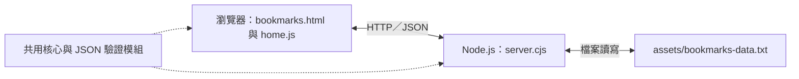

> 2026-10-25 拆站更新：下方目錄圖保留舊版架構背景；目前相簿程式、測試與參考資料已移至 `apps/growth/`，共用主題與資料鎖位於 `apps/shared/`。最新啟動方式與網址見 [Home 整合說明](home-integration.md)。

# Melody Pan：書籤工作台與成長相簿開發指南

> 整理日期：2026-10-24。內容依目前程式碼撰寫；一般操作說明請見[根目錄 README](../README.md)。

文件導覽：[書籤操作指南](user-guide.md) · [成長相簿操作與程式說明](../../growth/docs/growth-album.md)。

介面設計：[全站溫馨可愛主題說明](cozy-theme.md)。


功能規劃：[功能優化評估](optimization-review.md)，列出目前缺口與建議優先順序。

Logo 統一使用 Home 根目錄的 `images/logo.png`，書籤與成長相簿不保留圖片副本。

## 1. 專案簡介（Overview）

本專案將 Chrome 匯出的書籤整理成繁體中文的個人工作台，提供用途分類、原始資料夾與網址狀態篩選，以及搜尋與常用收藏。使用者可新增、刪除及復原書籤，手動調整分類與網址狀態；異動透過本機服務存入 JSON 資料檔。

首頁以精簡模式呈現，透過左側分類展開可編輯清單，並以天空藍與白底區分工作及生活書籤。

## 2. 技術棧（Tech Stack）

| 層級 | 使用技術 |
| --- | --- |
| 前端 | 原生 HTML、CSS、JavaScript，使用 DOM、Fetch、`dialog` 與響應式樣式；無前端框架 |
| 本機服務 | Node.js 22 以上；使用內建 `http`、`fs`、`path`、`crypto` 與 `child_process`、`https`、`dns`、`net` 模組，無後端框架 |
| 共用程式 | 瀏覽器與 Node.js 共用分類、篩選、資料合併及 JSON 格式驗證邏輯 |
| 資料儲存 | UTF-8 編碼的 JSON 文字檔；無資料庫。`localStorage` 保留瀏覽器快取與舊版設定相容功能 |
| 測試與工具 | Node.js 內建 `node:test`、`assert`；Windows 批次檔與 PowerShell；網址檢查工具另需 `curl.exe` |
| 套件管理 | 目前無 `package.json`、第三方套件或套件安裝步驟 |

## 3. 目錄結構（Directory Structure）

```text
Bookmarks/
├─ bookmarks.html                         產生的書籤網頁入口
├─ growth.html                        成長相簿入口
├─ README.md                          使用者操作說明
├─ Javascript/                       瀏覽器載入的程式
│  ├─ home.js                         書籤畫面、事件與自動存檔
│  ├─ growth.js                       相簿、大頭貼、封面及時間軸
│  ├─ bookmark-core.js                分類、搜尋、異動合併與共用規則
│  └─ bookmark-file.js                JSON 快照建立與格式驗證
├─ scripts/                          本機服務與開發工具
│  ├─ server.cjs                      HTTP、檔案讀寫與停止服務 API
│  ├─ growth-store.cjs                相簿資料驗證、照片與存檔
│  ├─ server-version.cjs              計算服務與共用模組的版本指紋
│  ├─ build-home.cjs                  由範本及原始資料產生首頁
│  ├─ check-bookmarks.cjs             重新檢查網址並產生報告
│  └─ url-checker.cjs                 網頁觸發的背景檢查、重新導向與結果合併
├─ src/
│  ├─ growth.css                      成長相簿樣式與響應式排版
│  ├─ home.html                       書籤 HTML 範本與對話框
│  └─ home.css                        配色、卡片與桌面／手機版樣式
├─ assets/
│  ├─ bookmarks-data.txt              主要資料檔，內容為 JSON
│  ├─ bookmarks-data.txt.bak          上一次成功寫入前的備份
│  ├─ growth-data.json                孩子與紀錄（首次開啟時建立）
│  ├─ growth-data.json.bak            相簿上一次存檔前的備份
│  ├─ growth-photos/                 故事照片與孩子大頭貼
│  ├─ source/
│  │  └─ bookmarks_2026_10_23.html    原始 Chrome 書籤匯出檔
│  └─ reports/
│     └─ bookmark-check-results.json  建置使用的網址檢查結果
├─ tests/
│  ├─ work-subcategories.test.cjs     第二層分類、排序及資料相容測試
│  ├─ category-order.test.cjs         第一層分類排序測試
│  ├─ bookmark-icons.test.cjs         網站圖示處理測試
│  ├─ bookmark-duplicates.test.cjs    重複網址、組合篩選及異動後重算測試
│  ├─ bookmark-editing.test.cjs       名稱網址編輯、失效結果重設與批次分類測試
│  ├─ bookmark-export.test.cjs        Chrome 書籤 HTML 匯出與還原驗證
│  ├─ bookmark-home.test.cjs          解析、分類、篩選與異動測試
│  ├─ bookmark-file.test.cjs          JSON 格式及還原測試
│  ├─ bookmark-server.test.cjs        HTTP、存檔、衝突與停止測試
│  ├─ url-checker.test.cjs            自動檢查、DNS 與時間記錄測試
│  └─ url-check-api.test.cjs          背景進度、取消與資料合併測試
└─ docs/
   ├─ README.md                      本文件
   ├─ growth-album.md                相簿操作、架構及程式說明
   ├─ user-guide.md                    中文功能與操作說明
   └─ history/                       初版設計與實作計畫
```

## 4. 架構與模組說明（Architecture & Modules）

### 整體架構

瀏覽器從 `http://127.0.0.1:4179/bookmarks/bookmarks.html` 載入首頁及三個 JavaScript 檔，透過同來源 Fetch 請求與 Node.js 服務溝通。服務僅綁定本機位址，負責讀寫資料檔；分類、搜尋及畫面呈現主要在瀏覽器完成。



### 核心模組

| 模組 | 主要職責與入口 |
| --- | --- |
| [home.js](../Javascript/home.js) | 管理首頁／清單／搜尋畫面，綁定新增、刪除、收藏及編輯事件；以 `queueFileSave()` 排隊傳送資料快照 |
| [bookmark-core.js](../Javascript/bookmark-core.js) | `parseBookmarks()` 解析原始書籤；`classify()` 判斷分類；`selectBookmarks()` 組合篩選；`mergeLibrary()` 套用新增、刪除、分類與狀態異動；`createChromeBookmarkHtml()` 輸出 Chrome 可匯入的 Netscape 書籤格式 |
| [bookmark-file.js](../Javascript/bookmark-file.js) | `createDataFile()` 建立完整快照；`readDataFile()` 驗證格式、識別碼、分類與收藏關聯，供前後端共用 |
| [server.cjs](../scripts/server.cjs) | 提供指定靜態資源與 API；驗證主機、寫入來源及資料格式；排隊存檔、檢查版本衝突並關閉服務 |
| [Home 啟動程式](../../../scripts/home-site-start.cjs) | `ensureHomeServer()` 檢查服務身分、專案路徑及版本；沿用相同版本，必要時停止舊版並啟動新版 |
| [server-version.cjs](../scripts/server-version.cjs) | 對服務、網址檢查器、書籤共用模組與相簿儲存模組計算 SHA-256 指紋，供啟動器判斷版本 |
| [build-home.cjs](../scripts/build-home.cjs) | 合併原始匯出檔與檢查結果，將 CSS、Logo 與初始資料嵌入 HTML；保留 `Javascript/` 的外部程式引用 |
| [url-checker.cjs](../scripts/url-checker.cjs) | 背景檢查目前未刪除的書籤，去除重複網址，以 HEAD／必要時 GET 檢查，驗證 DNS 與重新導向位址，將結果合併到最新資料 |
| [check-bookmarks.cjs](../scripts/check-bookmarks.cjs) | 透過 `curl.exe` 檢查網址，產生 JSON 與 HTML 報告；首頁開啟時不會自動執行 |

### 資料模型與規則

主要資料來源為 `assets/bookmarks-data.txt`，副檔名是 `.txt`，內容為 `schemaVersion: 1` 的 JSON。

| 欄位 | 用途 |
| --- | --- |
| `baseEntries` | 原始書籤基礎資料，包括識別碼、名稱、網址、原始資料夾、分類及檢查結果 |
| `changes.added`／`changes.deletedIds` | 手動新增項目與刪除紀錄；刪除紀錄可復原 |
| `changes.categoryOverrides`／`changes.statusOverrides` | 以書籤 ID 記錄手動分類與網址狀態 |
| `changes.entryOverrides` | 名稱及網址修改，保留書籤 ID；網址修改後先顯示未檢查，待新的自動檢查結果覆蓋 |
| `changes.urlChecks` | 自動檢查結果與每筆檢查時間；手動狀態優先顯示，恢復自動結果後可套用最新結果 |
| `changes.categoryOrder` | 第一層分類顯示順序 |
| `changes.workSubcategories` | 工作系統與程式開發的第二層分類，陣列順序為顯示順序；`category: "dev"` 表示程式開發，省略時為工作系統 |
| `changes.workSubcategoryAssignments` | 書籤 ID 與第二層分類 ID 的對應 |
| `favorites` | 收藏的書籤 ID 清單 |
| `entries` | 套用異動後的完整清單，附帶 `favorite` 欄位，由上述資料重新產生 |
| `updatedAt`／`checkedAt` | 存檔時間與最後一次完整檢查成功存檔的時間（舊資料沿用原始報告時間） |

- 書籤識別碼依原始內容與重複序號產生，重複網址仍保留各筆項目。
- 原始資料夾位於「中榮」或其子資料夾的書籤維持工作用途；工作用途包含 AI 工具、工作系統及程式開發分類。
- 用途、分類、原始資料夾、網址狀態、關鍵字及收藏可組合篩選；父資料夾包含其子資料夾。
- 手動修改網址狀態不會重新連線檢查，原始結果保留供恢復。

## 5. 主要資料流與 API（Data Flow）

### 載入、修改與停止

1. **載入**：啟動器確認服務 → 瀏覽器載入首頁 → 讀取 JSON 與 `ETag` → 驗證並合併資料 → 顯示精簡首頁。正常使用時，以資料檔內容為準。
2. **篩選**：操作左側導覽或搜尋 → 更新前端狀態 → 共用核心篩選 → 重繪卡片，不額外查詢遠端網站。
3. **存檔**：編輯書籤 → 更新記憶體資料 → 產生完整快照 → 排隊送出 `PUT` → 服務檢查 `If-Match` → 備份舊檔、寫入暫存檔再替換正式檔 → 回傳新版本。
4. **重新檢查**：說明視窗按「重新檢查網址」→ 啟動背景工作 → 輪詢進度 → 合併到最新資料並備份存檔 → 更新畫面與台灣時間。手動標記、收藏及其他視窗的異動會保留；檢查中途停止或失敗不更新最後完成時間。
5. **停止**：Home 整合版先確認各分頁資料已儲存 → 到 `/admin/` 儲存作品變更（若有） → 按「停止服務」並確認 → 呼叫停止 API → 服務取消進行中的網址檢查，等待已接受的寫入完成並關閉 HTTP 監聽。若後台仍有未儲存變更，前端保留服務並提示先儲存。

### HTTP 介面

| 方法 | 路徑 | 說明 |
| --- | --- | --- |
| `GET` | `/`、`/bookmarks.html` | 取得首頁 |
| `GET` | `/index.html` | 舊網址轉址至 `/bookmarks.html`，不保留舊檔案 |
| `GET` | `/Javascript/home.js`、`/Javascript/bookmark-core.js`、`/Javascript/bookmark-file.js` | 取得指定瀏覽器程式 |
| `GET` | `/assets/bookmarks-data.txt` | 回傳 JSON 文字及 SHA-256 `ETag`；回應類型為 `text/plain` |
| `GET` | `/api/health` | 回傳服務識別、專案路徑、版本指紋及停止中狀態 |
| `PUT` | `/api/bookmarks` | 接收完整 JSON 快照，需 `Content-Type: application/json`、同來源 `Origin` 與目前 `If-Match`；成功回傳 `{ "revision": "…" }` |
| `POST` | `/api/url-check` | 傳送 `{}`、同來源 JSON 標頭與目前 `If-Match`，檢查目前書籤；成功回傳 `202` 與背景工作資訊 |
| `GET` | `/api/url-check` | 取得工作狀態、已檢查／總網址數、開始／完成時間與錯誤訊息 |
| `POST` | `/api/shutdown` | 傳送 `{}`，需 JSON 類型及同來源 `Origin`；成功回傳 `{ "stopped": true }` 並停止服務 |

寫入上限為 5 MB。錯誤包含 `400`（格式不合法）、`403`（主機或來源不符）、`409`（資料已被其他視窗或程式修改）、`413`（資料過大）、`503`（服務停止中）及 `500`（檔案讀寫失敗）。遇到 `409` 應重新載入資料，避免覆蓋其他異動。

## 6. 開發與建置指南（Getting Started）

### 環境需求與啟動

- Windows、Node.js 22 以上及 Chrome 等現代瀏覽器；一鍵啟動使用 PowerShell 開啟預設瀏覽器。
- Home 首次使用請在根目錄執行 `npm install`，安裝 Google 登入所需套件。
- 請保留專案目錄結構，並確保 `assets/` 可寫入及本機 4179 埠可用。

在專案根目錄開啟 PowerShell：

```powershell
node --version
.\start-home.cmd
```

啟動器會開啟 Home 首頁 `http://127.0.0.1:4179/`，再從首頁進入書籤工作台。開發時若需要直接查看服務輸出，可執行：

```powershell
node scripts/home-site-server.cjs
```

直接執行服務時可按 `Ctrl+C` 停止；Home 整合版可在 `/admin/` 右上角使用「停止服務」，不需登入。關閉分頁不會停止服務，完全停止後需再執行啟動檔。

### 建置與測試

```powershell
node scripts/build-home.cjs
node --test
```

修改 `src/home.html` 或 `src/home.css` 後需重新建置；修改 `Javascript/` 後重新整理網頁即可。修改服務或共用資料模組後，重新執行啟動檔以檢查並更新執行版本。

`bookmarks.html` 是產物，應修改範本再重建。建置只會在主要資料檔不存在時建立初始 JSON，**不會覆蓋既有書籤資料**；原始匯出檔包含 546 筆，實際清單數量依目前資料檔與刪除紀錄計算。

測試涵蓋原始資料解析、分類、複合篩選、手動異動、格式驗證、啟動器、檔案備份、存檔衝突與停止 API。測試中的服務使用暫存資料夾與動態埠，避免寫入正式資料檔。

### 從網頁重新檢查

首頁右上角「?」→「重新檢查網址」。介面顯示進度與「最後完成檢查」的台灣時間，結果自動寫入主要資料檔。檢查只由使用者點選啟動；同一網址只檢查一次，內部／特殊網址及指向內部或保留位址的網域會略過，逾時或憑證問題列為待人工確認。檢查期間目前分頁暫停編輯，可關閉說明視窗，背景工作仍會繼續。

### 命令列更新原始檢查報告

```powershell
node scripts/check-bookmarks.cjs
node scripts/build-home.cjs
```

檢查工具需要 `curl.exe`，會對符合條件的外部網址發送請求，產物放入 `assets/reports/`；內部或特殊網址會略過。這會更新檢查報告與首頁內嵌初始資料，**不會自動把新結果套用到既有 `bookmarks-data.txt`**。

### 匯出格式

- 「匯出 Chrome 書籤」：瀏覽器從完整的有效清單產生 bookmarks-chrome.html，採 UTF-8 與 Netscape 書籤格式，依工作用途／生活及目前分類分層，保留重複項目並排除已刪除項目；文字與網址會進行 HTML 跳脫。
- 「備份 JSON」：下載 bookmarks-data.txt，保留完整原始路徑、狀態、收藏與異動紀錄。舊版設定搬移應使用此按鈕。
- Chrome 匯入方式可參閱 [Google 官方說明](https://support.google.com/chrome/answer/96816?hl=zh-Hant)。

### 資料與操作注意事項

- 正式讀寫須透過本機 HTTP 服務；直接雙擊 `bookmarks.html` 無法自動讀寫旁邊的資料檔，僅可檢視初始資料／舊版快取並匯出。重新檢查功能會顯示未連線原因，提供「開啟本機版」入口；需先執行啟動檔，入口不會自行執行本機程式。
- 備份主要資料檔與 `.bak` 即可保留書籤異動；備份整個網站時也應保留 `Javascript/`、`scripts/` 等目錄。
- 若手動編輯 JSON，應修改 `baseEntries`、`changes` 或 `favorites`；`entries` 是衍生清單，下次存檔會重新計算。

## 7. 歷史文件

- [初版設計](history/2026-10-23-initial-design.md)
- [初版實作計畫](history/2026-10-23-initial-implementation-plan.md)

上述文件保留早期規劃；其中的單檔離線模式、配色、儲存方式與舊路徑已經演進，目前架構以本文件為準。

## 第二層分類與搜尋排序

選擇左側「工作系統」或「程式開發」，點「管理第二層分類」即可新增、重新命名及刪除分類，並使用「上移／下移」調整顯示順序。兩個主分類的子分類分開管理；「未分類」固定放在最後。編輯或新增這兩類書籤時，可選擇第二層分類；點左側子分類即可篩選。刪除分類只會讓書籤回到「未分類」。

設定以 JSON 的 `changes.workSubcategories` 與 `changes.workSubcategoryAssignments` 自動存入 `assets/bookmarks-data.txt`，排序依 `changes.workSubcategories` 陣列順序保存；子分類的 `category` 為 `dev` 時屬於程式開發，省略時沿用既有工作系統設定。Chrome 書籤匯出也會保留第二層資料夾與自訂順序。關鍵字搜尋包含子分類名稱，結果優先顯示「工作系統」，其他分類接在後面；各組內維持選定的排序。未輸入關鍵字時沿用既有排序。

## 書籤顯示方式

書籤結果區右上角提供「格狀／清單」切換，適用於所有書籤、常用收藏、分類及搜尋結果。切換會保留目前篩選與排序，清單同樣可收藏、刪除、修改分類及網址狀態。顯示偏好以瀏覽器 localStorage 的 `melody-pan-bookmark-layout` 儲存，下次開啟時沿用；不影響書籤 JSON 資料。

## 第一層分類排序

點左側「依用途探索」旁的「分類排序」，用「上移／下移」調整第一層分類，或按「恢復預設順序」。順序會自動寫入 `assets/bookmarks-data.txt` 的 `changes.categoryOrder`，重新開啟仍會保留；第二層分類會跟隨各自主分類。「所有書籤」與「常用收藏」固定保留在頂端。

## 網站圖示

書籤卡片與清單顯示網站圖示。建置時從原始 Chrome 匯出檔讀取內嵌點陣圖示，放入首頁資料；缺少圖示時，瀏覽器以延遲載入方式向網站自己的 `/favicon.ico` 請求，不使用第三方圖示服務，也不傳送書籤頁面路徑或 Referer。圖示載入失敗時保留文字替代圖示。原始書籤資料與使用者異動 JSON 保持原格式。

## 9. 成長電子相簿

完整中文說明已集中至 [成長電子相簿：操作與程式說明](growth-album.md)，包含：

- 多位孩子、大頭貼、紀錄封面、翻頁與時間軸的操作。
- 檔案分工、前端狀態與主要函式。
- JSON 格式、選填欄位相容性、資料驗證與限制。
- 照片上傳、完整快照存檔、版本衝突與備份流程。
- API、錯誤處理、還原與測試入口。

相簿沿用本機 Node 服務與啟動檔，入口為 `/growth.html`；資料保存在 `assets/growth-data.json` 及 `assets/growth-photos/`，與書籤資料分開。

## 10. 全站共用主題

書籤工作台與成長相簿共用 `src/cozy-theme.css`，以 `body[data-page]` 區分各頁調整。完整設計變數、載入順序與維護方式請見 [溫馨可愛主題說明](cozy-theme.md)。
