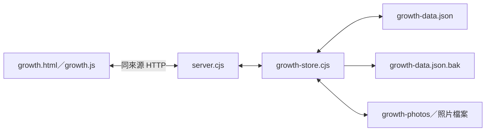

# 成長電子相簿：操作與程式說明

更新日期：2026-10-25。內容依目前程式碼整理。

導覽：[Home 整合說明](../../bookmarks/docs/home-integration.md) · [書籤操作指南](../../bookmarks/docs/user-guide.md) · [專案說明](../README.md)

## 1. 功能與使用方式

執行 Home 根目錄的 `start-home.cmd` 或 `npm start`，從 Home 首頁點「成長相簿」，或開啟 `http://127.0.0.1:4179/growth/`。

目前以「繽紛童趣」版型搭配[全站溫馨可愛主題](../../bookmarks/docs/cozy-theme.md)：淡紫底色、拍立得照片與便條紙故事。桌面以左側孩子導覽搭配右側內容；較窄畫面改用孩子下拉選單。此為本機網站，同一台電腦上的瀏覽器透過服務存取檔案，其他裝置無法透過自己的 `127.0.0.1` 連到這台電腦。

| 功能 | 操作與結果 |
| --- | --- |
| 新增孩子 | 填寫名字／暱稱，尚未出生可先留白生日；孩子之間的故事分開顯示 |
| 孕期紀錄 | 可新增早於生日的故事，收藏產檢、超音波照片或第一次胎動 |
| 大頭貼 | 在新增或編輯孩子時選照，預覽後按「儲存孩子」；可更換或移除 |
| 成長手帳 | 每頁顯示一筆紀錄的照片、故事、日期、年齡與里程碑 |
| 新增紀錄 | 填寫日期、標題、故事及選填的里程碑，照片可不選 |
| 指定封面 | 在紀錄編輯視窗，點照片下方「設為封面」，再儲存紀錄 |
| 管理紀錄 | 以清單查看、編輯或刪除紀錄，也能翻到指定故事 |
| 時間軸預覽 | 點孩子旁的「預覽」，或選擇孩子後按「預覽成長時間軸」 |
| 電子書預覽 | 專屬書封、章節目錄與多照片雜誌跨頁，保留立體翻頁 |
| 成長數字 | 每筆紀錄可選填身高、體重，查看目前孩子的曲線與量測明細 |
| 搜尋與篩選 | 年份可搭配標題、故事、里程碑或日期關鍵字，五種顯示模式共用結果 |

點左上角 Logo 回到成長相簿入口；右上角「← 書籤首頁」回到書籤網站。一般載入、儲存成功的提示列隱藏，錯誤時才顯示。

### 從孕期開始記錄

新增孩子時填入名字或暱稱即可，生日為選填，出生後再補上實際生日。紀錄日期可以早於生日，新故事預設今天。里程碑提供「孕期」、「產檢」、「胎動」選項，也可以自行輸入。

未填生日時，年齡位置顯示「還在肚子裡」；有生日且紀錄早於生日，顯示「出生前 N 天」。出生當天及之後沿用原有的天數、月齡或歲數。這些文字由手帳、時間軸、電子書及管理清單共用，不會顯示負數年齡。未提供孕週計算。

補填或修改生日會重新計算顯示文字，原有故事、日期、照片及封面保持原樣；也不會阻止保存已經存在的孕期紀錄。未填生日在 JSON 統一保存為空字串 `""`，API 也接受省略欄位或 `null`，既有生日資料相容。

### 成長數字：身高與體重

在「新增成長紀錄」或「編輯成長紀錄」的「成長數字」區塊，填入孩子當天的身高（cm）與體重（kg）。兩欄都選填，可只填一項；支援小數，體重 3,125 公克請輸入 `3.125` 公斤。編輯時清空欄位並儲存，可移除那一項量測，不影響照片、故事或另一項數字。

選擇孩子後按「成長數字」：

- 身高與體重分成兩張方格紙式生長圖，各自顯示單位、刻度、最近一次量測及日期。
- 在「編輯孩子」選擇「生長曲線參考：男孩／女孩」，並填寫生日。橫軸為出生至 7 歲，圓點依量測當天的實際月齡定位，同一天多筆紀錄均保留。
- 背景顯示 P3、P15、P50、P85、P97，男孩與女孩使用各自資料。未選參考性別不猜測，仍可顯示個人年齡量測點；未填生日暫時保留依日期排列的曲線。
- 紫色點與連線是孩子的實際量測，最新圖上量測點較大；點選、鍵盤選取或移入圓點，可看日期、年齡與數值。手機圖表可左右捲動。
- 缺值不當成零，也不補推數字；只有故事、沒有量測的紀錄仍正常保留。
- 下方量測表列出日期、故事、身高與體重，按「編輯」回到原本那筆故事。完整數值以表格提供，也方便使用輔助閱讀工具。
- 年份與搜尋條件同時套用，卡片上的「最新量測」指目前篩選結果中的最新日期；兩項數字的量測日期可能不同。
- 沒有數字時顯示填寫提示；沒有符合條件的故事時，沿用相簿空狀態。可從上方「新增成長紀錄」加入新故事。

量測同時會出現在手帳、管理清單及電子書中。孕期故事也可保存數字，欄位代表孩子本人的量測；孕期與超過 7 歲的數字保留明細，不強行夾到 0–7 歲圖框。圖表會標示未納入筆數。有效但超出一般刻度的量測會擴展縱軸，不偷偷裁掉或修改數字。

參考資料採官方數據節點連線：身長 0–2 歲、體重 0–5 歲使用 WHO 逐月表，後續至 7 歲使用國健署半年表。背景線供位置參考，不計算孩子的精確百分位，也不做體位或疾病判斷。圖下提供來源與方法說明；原檔、來源連結、雜湊與再產生方式詳見[生長參考資料來源](data/README.md)。

輸入限制為身高大於 0 且不超過 300 cm、體重大於 0 且不超過 500 kg，這是程式防誤輸入的界限。前端先驗證數字再上傳照片，後端再次確認型別、有限值及範圍；不接受字串、負數或零。

#### 數字模組與資料欄位

`Javascript/growth-metrics.js` 集中處理 `parseInput()`（空白與輸入驗證）、`label()`（手帳等畫面的文字）、`series()`（孩子隔離與日期排序）、`plot()`（未填生日的日期曲線）、`ageMonths()`（日曆月週年日與當月比例）、`agePlot()`／`ageChart()`（0–84 月定位與參考線）及 `render()`（SVG 和表格）。`Javascript/growth-reference.js` 是由官方原檔產生的離線資料，必須在數字模組前載入。`src/growth-metrics.css` 維護方格紙、參考線與窄螢幕橫向捲動；不載入外部圖表套件。

紀錄新增可省略的數字欄位 `heightCm` 與 `weightKg`，例如 `"heightCm": 85.5, "weightKg": 12.35`。未填寫時省略欄位；API 也接受 `null` 表示清空。維持 `schemaVersion: 1`，舊紀錄不補成 0。既有備份、版本衝突檢查及照片保存流程維持原有方式。

孩子的選填欄位 `growthSex` 接受 `male`／`female`；空字串、`null` 或省略表示未選擇，保存時省略欄位。生日及參考設定變更後即重新定位，不修改原量測紀錄。顯示參考資料完全在本機完成，不會把生日或量測傳到官方網站。

### 大頭貼

照片會顯示在桌面孩子導覽與手機孩子選單旁。沒有設定或圖片讀取失敗時，改顯示名字的第一個字。

選照後先建立瀏覽器內的暫時預覽，按「儲存孩子」才縮圖、上傳並保存關聯；放棄編輯不會把草稿套用到孩子資料。圖片以中央區域顯示，不提供手動裁切介面。

### 紀錄封面與翻頁

封面是照片的獨立指定，不會重新排列照片。相簿初次開啟該筆故事、管理清單與時間軸都優先使用封面。使用者在故事內點其他縮圖後，可以繼續查看其他照片。

舊紀錄未指定封面時，沿用第一張照片；編輯時刪除目前封面，會自動選用剩餘第一張，全部刪除則清空封面。

可按相簿下方左右箭頭翻頁；相簿取得焦點後支援鍵盤左右鍵。觸控翻頁只接受明顯水平的單指滑動，略過按鈕及故事文字區，減少和垂直捲動衝突。

### 時間軸

時間軸由早到晚呈現每筆紀錄的日期、當時年齡、標題與封面。沒有照片的紀錄仍顯示，圖片位置標示「尚未加入照片」。

點時間點的卡片後，回到同一份篩選結果中的對應故事，從封面開始翻閱。也可以按「返回相簿」或「成長手帳」切回。時間軸是目前頁面的一種顯示模式，不是另外複製的資料。

### 電子書

在預覽區按「電子書」，即可把目前孩子的紀錄當作一本書閱讀。從專屬書封與目錄開始，接著以雜誌跨頁呈現故事與全部照片。桌面為左右跨頁；650px 以下改為上下直式頁面。長故事與寄語可以在文字區捲動。

#### 專屬書封

按電子書上方「編輯書封」，或從「編輯孩子」進入「專屬書封」區塊，可填寫書名、寫給孩子的話，以及獨立書封照片，按「儲存孩子」後生效。書封圖片與大頭貼分開設定，每位孩子各自保存。

未填書名使用「孩子名字的成長故事」；沒有寄語時使用預設文字。未指定書封照片時，依序使用大頭貼、目前篩選故事的照片，皆無照片則顯示愛心底圖。書封採中央裁切滿版，故事照片則保留完整比例。書封照片可移除，會回到自動選照；原磁碟照片不刪除。

#### 章節目錄與雜誌排版

- 自動依日期分成「孕期篇」與各年份的「成長篇」。未填生日時，目前故事都歸孕期篇；補生日後重新分章。
- 書內第二個跨頁是可點選的章節目錄；書本上方也可展開「章節目錄」，直接跳到章節、書封或目錄頁。
- 新增／編輯成長紀錄時，可選「雜誌拼貼」、「整齊格狀」、「大圖」。舊紀錄預設雜誌拼貼。
- 雜誌拼貼每半頁最多 3 張、格狀最多 4 張、大圖 1 張。第一個跨頁左側照片、右側完整故事；其餘照片自動延伸為照片跨頁，20 張也會全部呈現。
- 同筆紀錄優先呈現指定封面，其餘照片依原順序排版，不修改保存的照片陣列。無照片的故事仍有文字頁。
- 年份與搜尋同樣套用，目錄只列出目前結果；切換孩子或篩選後從書封開始。沒有符合的故事則顯示共用空狀態。

- 點下方箭頭，或點書頁左右外緣，可閱讀前後一個跨頁。
- 按住紙張外側約 20% 的區域左右拖曳，紙張會跟著翻動；超過頁寬 22% 才完成換頁，否則回到原頁。垂直手勢與系統取消手勢不換頁。
- 用 Tab 選取書本後，可以使用鍵盤左右鍵。開啟系統「減少動態效果」時直接換頁。
- 「返回成長手帳」會回到目前故事；照片續頁也對應原本同一段故事。書封或目錄則保留上次故事位置。
- 切換孩子、年份、搜尋或顯示模式時，會取消尚未完成的翻頁。電子書與手帳保留同一個故事位置；沒有符合的紀錄時顯示共用空狀態。

此功能以本機 CSS 3D 及 Web Animations API 製作紙張正反面、書脊與陰影，沒有載入外部翻頁服務，也不會將照片上傳到 FlipHTML5。它提供本機相簿的翻頁閱讀功能，未包含 FlipHTML5 的線上出版、分享或多媒體編輯工具。

#### 電子書程式說明

| 檔案／方法 | 用途 |
| --- | --- |
| `Javascript/growth-flipbook.js` | 獨立電子書模組，瀏覽器使用 `GrowthFlipbook.Flipbook`；Node 測試使用 CommonJS 匯出 |
| `TurnState` | 管理目前頁、目標頁、方向與拖曳進度；翻動期間拒絕重複換頁，完成後才提交頁碼 |
| `buildBook()` | 建立書封、目錄、故事與照片續頁，保留 `recordIndex` 與穩定 `key`，不改來源照片順序 |
| `magazinePage()`／`chapterButtons()` | 建立雜誌照片版型、扉頁寄語及可直接跳頁的章節按鈕 |
| `jump()`／`notify()` | 跳頁前取消舊動畫，以來源故事索引與跨頁 key 同步主程式，避免把續頁當作別筆故事 |
| `Flipbook.setRecords()` | 接收篩選後的紀錄、目前頁及孩子；取消舊動畫並重畫，版本號阻止舊非同步動畫寫回 |
| `page()`／`spread()` | 以 DOM 與 `textContent` 建立照片頁及故事頁，不把使用者文字解析成 HTML |
| `prepare()`／`settle()` | 建立獨立紙張的正反面、播放或取消旋轉；動畫完成後用 `onChange` 同步主頁頁碼 |
| `pointerDown()`／`pointerMove()`／`pointerEnd()` | 限定外緣操作、追蹤水平拖曳、釋放指標捕捉，並判斷換頁或回彈 |
| `src/growth-flipbook.css` | 紙張正反面、3D 書脊旋轉、暖色陰影，以及手機直式版面 |
| `Javascript/growth.js` | 註冊電子書頁籤，傳入 `records()` 結果，將閱讀位置同步到既有手帳 |
| `scripts/server.cjs` | 明確允許電子書 JS／CSS 靜態路徑；不開放任意檔案存取 |

孩子新增可選 `bookTitle`（最多 120 字）、`bookDedication`（最多 2,000 字）、`bookCover`（本機照片 ID）；故事新增可選 `photoLayout`（`editorial`、`grid`、`full`）。維持 `schemaVersion: 1`，舊資料直接相容。照片上傳與實體存在驗證沿用既有服務；書封草稿的 Blob 在更換／關閉時釋放，JSON 保存失敗時保留已上傳 ID 供重試。翻頁與跳目錄只改變記憶體中的閱讀位置，不執行存檔 API。

## 2. 檔案與模組

| 檔案 | 職責 |
| --- | --- |
| [growth.html](../growth.html) | 相簿入口、孩子導覽、五種顯示模式及維護對話框 |
| [src/growth.css](../src/growth.css) | 童趣樣式、拍立得、便條紙、時間軸及響應式排版 |
| [Javascript/growth.js](../Javascript/growth.js) | 畫面狀態、事件、草稿、縮圖、API 存取及時間軸 |
| [scripts/growth-store.cjs](../scripts/growth-store.cjs) | 資料驗證、照片上傳、JSON 讀寫、備份與衝突檢查 |
| [scripts/server.cjs](../scripts/server.cjs) | 共用本機服務，將相簿路由交給儲存模組，提供指定靜態資源 |
| [scripts/server-version.cjs](../scripts/server-version.cjs) | 計算服務版本指紋，包含相簿儲存模組 |
| [scripts/start-bookmarks.cjs](../scripts/start-bookmarks.cjs) | 確認服務身分、專案路徑及版本，必要時重啟同專案舊服務 |

相簿直接使用 `growth.html`，不由首頁建置工具產生。修改 HTML、CSS 或前端 JS 後重新整理即可；修改服務程式後，重新執行啟動檔更新執行版本。首頁範本仍由 `scripts/build-home.cjs` 產生 `bookmarks.html`。

## 3. 架構與資料流



### 載入與切換畫面

1. 前端向 `GET /api/growth` 取得完整相簿與 `ETag`。
2. 選取目前孩子，建立桌面側欄與手機選單。
3. `allRecords()` 限定孩子，依日期排序，同日期以識別碼作穩定排序。
4. `records()` 套用年份與關鍵字條件。
5. `render()` 依模式顯示相簿、維護清單或時間軸。切換模式及篩選不寫入磁碟。

### 保存照片與紀錄

1. 使用者選照，前端以 `blob:` 網址建立暫時預覽。
2. 按儲存後解碼照片，等比例縮圖並轉成 JPEG。
3. 將新照片的二進位內容送到 `POST /api/growth/photos`，取得照片 ID。
4. 把照片 ID 寫入孩子的 `avatar`／`bookCover`，或紀錄的 `photos`、`coverPhoto`。
5. 用 `PUT /api/growth` 送出完整 JSON 快照，並以 `If-Match` 帶入載入時的版本。
6. 服務在寫入佇列內重新讀檔、檢查版本與引用照片，備份舊檔並替換正式檔。
7. 收到成功回應後，前端才更新已儲存資料、版本及未儲存狀態。

照片上傳與 JSON 存檔是兩個步驟。若照片已上傳但 JSON 失敗，草稿保留照片 ID，再試時不會重複上傳；放棄草稿或刪除紀錄也不會自動刪除磁碟照片。

## 4. 前端狀態與主要函式

### 狀態欄位

| 欄位 | 意義 |
| --- | --- |
| `data`、`revision` | 已成功載入／保存的資料，以及與檔案內容對應的版本 |
| `childId` | 目前孩子的識別碼 |
| `mode` | `album` 成長手帳、`manage` 管理紀錄、`timeline` 時間軸 |
| `page` | 篩選後紀錄的索引，從 0 開始 |
| `photo` | 目前照片索引；`null` 表示進入故事時先使用封面 |
| `busy` | 非同步儲存中，防止重複送出或修改處理中的資料 |
| `dirty` | 表單有未儲存編輯，供關閉或離開時提醒 |
| `childEdit`、`recordEdit` | 正在編輯的孩子／紀錄 ID；新增時為 `null` |
| `draft` | 照片草稿陣列，可同時包含既有照片與尚未上傳的檔案 |
| `avatarDraft` | 大頭貼草稿，包含可選的 `file`、`id` 及預覽網址 `preview` |
| `coverDraft` | 指向 `draft` 中的照片物件，不以陣列位置追蹤封面 |

草稿狀態只存在瀏覽器記憶體，沒有另外保存到 `localStorage`。離開前的提醒不能取代儲存。

### 函式分工

| 函式 | 說明 |
| --- | --- |
| `selectChild(id, mode)` | 選取孩子，可直接進入時間軸；重設上一位孩子的搜尋、年份、頁碼與照片索引 |
| `setMode(mode)`、`render()` | 切換模式及重繪；沒有符合紀錄時顯示共用空狀態 |
| `renderBook(list)`、`flip(delta)` | 顯示故事、處理封面預設及翻頁邊界 |
| `renderList(list)` | 建立可編輯、可翻到故事的維護清單 |
| `renderTimeline(list)` | 建立有序清單與 `time` 元素，卡片索引對應同一份篩選結果 |
| `ageAt(birthday, date)` | 未填生日顯示孕期文字，出生前顯示相距天數，出生後計算完整月齡／年齡 |
| `fillAvatar(container, child)` | 顯示大頭貼，無設定或讀取失敗時使用名字圖示 |
| `openChild()`、`setChildAvatar()`、`renderChildAvatar()` | 開啟孩子表單、更新大頭貼草稿與預覽 |
| `openRecord()`、`renderDraft()`、`clearDraft()` | 管理照片草稿、封面、移除操作及預覽資源釋放 |
| `compressPhoto(file, maxEdge)` | 等比例縮圖，預設故事長邊 1800、大頭貼傳入 512；不放大小照片 |
| `jsonRequest()` | 統一處理連線、JSON 解析與 HTTP 錯誤 |
| `commit(next)` | 保存完整快照；成功後才更新前端資料與版本 |
| `busy(errorId, work)`、`controls()` | 儲存期間鎖定操作，失敗保留表單，結束後恢復 |
| `closeDialog()` | 放棄未儲存編輯前確認，配合對話框關閉事件釋放預覽網址 |

孩子名字、故事標題與內容透過 `textContent` 顯示，不作為 HTML 插入。暫時建立的 `blob:` 預覽須用 `URL.revokeObjectURL()` 釋放；既有照片的服務網址不需執行此操作。

## 5. 資料格式與相容性

正式檔案是 `assets/growth-data.json`，UTF-8 編碼，格式版本為 `schemaVersion: 1`。以下為說明用資料，照片 ID 僅為格式範例，實際使用時必須有對應照片檔案。

```json
{
  "schemaVersion": 1,
  "updatedAt": "2026-10-24T00:00:00.000Z",
  "children": [
    {
      "id": "child-example",
      "name": "小星",
      "birthday": "2023-06-15",
      "avatar": "00000000-0000-4000-8000-000000000003.jpg"
    }
  ],
  "records": [
    {
      "id": "record-example",
      "childId": "child-example",
      "date": "2024-06-15",
      "title": "第一個生日",
      "story": "一起吹蠟燭，收藏今天的笑容。",
      "milestone": "生日",
      "photos": [
        "00000000-0000-4000-8000-000000000001.jpg",
        "00000000-0000-4000-8000-000000000002.jpg"
      ],
      "coverPhoto": "00000000-0000-4000-8000-000000000002.jpg"
    }
  ]
}
```

`avatar` 與 `coverPhoto` 可省略，送出 `null` 可表示清除設定；服務保存時省略未設定的選填欄位。舊資料無須修改格式版本，前端會提供名字圖示或第一張照片作為預設。

`coverPhoto` 必須出現在同一筆紀錄的 `photos` 中。封面引用的是照片 ID，所以改封面不需要調整照片順序，也不會另外複製圖片。

### 驗證與限制

| 項目 | 限制 |
| --- | --- |
| 孩子／紀錄數量 | 最多 100 位孩子、10000 筆紀錄 |
| 孩子名字 | 必填，最多 80 字元 |
| 日期 | 紀錄日期必填且為有效的 `YYYY-MM-DD`，允許早於生日；生日可留白，有填寫仍須有效 |
| 標題／故事／里程碑 | 標題必填且最多 160 字元；故事 20000；里程碑 80 |
| 每筆紀錄照片 | 最多 20 張，照片 ID 不重複 |
| 選照格式／原檔大小 | JPG、PNG、WebP；每張最多 12 MB |
| 縮圖 | 故事最長邊 1800、大頭貼 512 像素；JPEG 品質 0.88，透明背景轉白 |
| 解碼後圖片 | 瀏覽器拒絕超過 60000000 像素的圖片 |
| JSON 請求 | 最多 8 MB；照片另行上傳，不內嵌於 JSON |

原始照片不會被修改。瀏覽器重新編碼後的檔案不保留原始 EXIF 或透明背景。後端另外檢查照片 MIME、大小及檔頭，檔頭檢查本身不等同完整圖片解碼。

## 6. 本機介面與存檔機制

| 方法與路徑 | 請求／回應 |
| --- | --- |
| `GET /api/growth` | 回傳完整相簿與 `ETag`；只在資料檔不存在時建立空白相簿 |
| `PUT /api/growth` | JSON 快照、同來源 `Origin`、`Content-Type: application/json`、目前 `If-Match`；成功回傳 `revision`、`updatedAt` |
| `POST /api/growth/photos` | 同來源 `Origin`、圖片 MIME 與二進位內容；成功回傳 `201` 及 `{ "id": "…" }` |
| `GET /assets/growth-photos/<uuid>.<ext>` | 提供指定 UUID 照片；不存在或檔名不合法回傳 `404` |

`server.cjs` 先檢查本機 Host，再讓 `growth-store.cjs` 接手相簿 API 與照片路徑。其他請求繼續走原有路由。相簿靜態檔只開放指定的 HTML、CSS、JS，不公開整個專案目錄。

`createGrowthStore(root)` 回傳 `handle()` 與 `flush()`。`handle()` 處理相簿請求後回傳 `true`；不屬於它的路徑回傳 `false`。`flush()` 等待目前已排隊的寫入，供停止服務使用。

同一服務內的相簿寫入依序執行。版本值是完整檔案內容的 SHA-256，服務會在佇列內重新讀檔比對 `If-Match`，避免多個視窗互相覆蓋。備份舊版至 `.bak` 後，先寫 `.tmp`，再用 `rename` 替換正式 JSON。讀取或驗證既有檔案失敗時回報錯誤，不自動清空資料。

| 狀態碼 | 常見原因與處理 |
| --- | --- |
| `400` | 資料、日期或關聯不合法，或引用照片不存在；修正表單或重選照片 |
| `403` | 來源或 JSON 內容型別不符；透過本機服務的正常介面操作 |
| `409` | 其他視窗或程式已修改資料；先複製未儲存內容，再重新整理 |
| `413`／`415` | 內容超量／不支援的照片格式；改用符合限制的檔案 |
| `500` | 檔案損毀或讀寫失敗；檢查檔案、權限或還原備份 |
| `503` | 服務正在停止；重新啟動後再試 |

## 7. 備份、還原與刪除

| 位置 | 用途 |
| --- | --- |
| `assets/growth-data.json` | 孩子、故事、大頭貼與封面關聯 |
| `assets/growth-data.json.bak` | 上一次成功存檔前的 JSON，只保留上一版 |
| `assets/growth-photos/` | 故事照片與大頭貼實體檔案 |

等待儲存完成後，將整個 `assets` 資料夾複製到備份位置。還原時先停止服務，再一起還原 JSON 與照片目錄；只還原 JSON 無法補回已遺失的圖片。

刪除孩子會連同其故事關聯移除；刪除紀錄或移除照片不清除磁碟照片，讓上一版備份仍能引用它們。上傳成功但放棄儲存的照片也會保留。目前沒有自動清理未引用照片或多版本回收桶功能。

## 8. 測試與維護入口

在專案根目錄執行：

```powershell
node --check Javascript/growth.js
node --check Javascript/growth-flipbook.js
node --check Javascript/growth-metrics.js
node --check scripts/growth-store.cjs
node --test
```

| 測試檔 | 驗證重點 |
| --- | --- |
| [growth-server.test.cjs](../tests/growth-server.test.cjs) | 初始化、備份、跨視窗衝突、照片限制、資料驗證、大頭貼及封面的保存 |
| [growth-image.test.cjs](../tests/growth-image.test.cjs) | 縮圖尺寸、小圖不放大、超量圖片拒絕及解碼資源釋放 |
| [growth-drafts.test.cjs](../tests/growth-drafts.test.cjs) | 封面選擇、不改照片順序、刪除回退與儲存鎖定 |
| [growth-display.test.cjs](../tests/growth-display.test.cjs) | 相簿封面預設、大頭貼替代圖示及草稿清理 |
| [growth-timeline.test.cjs](../tests/growth-timeline.test.cjs) | 時間軸日期／標題／封面、返回故事、孩子隔離及組合篩選 |
| [growth-flipbook.test.cjs](../tests/growth-flipbook.test.cjs) | 翻頁邊界、指定封面、文字紀錄、動畫取消、正反紙張、手機拖曳與取消手勢 |
| [growth-pregnancy.test.cjs](../tests/growth-pregnancy.test.cjs) | 孕期保存、生日選填與補填、出生前天數、原有年齡及紀錄日期預設 |
| [growth-metrics.test.cjs](../tests/growth-metrics.test.cjs) | 數字選填／清除、錯誤型別與邊界、孩子隔離、日期比例、單點／同日及圖表表格 |
| [growth-magazine.test.cjs](../tests/growth-magazine.test.cjs) | 書封／目錄章節、三種版型完整照片涵蓋、續頁來源映射與新欄位驗證 |
| [growth-percentiles.test.cjs](../tests/growth-percentiles.test.cjs) | 生日／閏日月齡、官方數值與來源雜湊、出生／超齡範圍、性別設定及可操作年齡圖表 |

HTTP 測試使用獨立暫存資料夾及動態連接埠，不把示意孩子寫入正式資料。前端邏輯測試使用最小 DOM／Canvas 替身執行實際函式；這些測試不代表已完成真實瀏覽器的版面、選照與觸控檢查。

若要調整版面，先查看 `growth.html` 的識別碼及 `growth.css` 的中文區段註解；調整互動則查看 `growth.js`。新增資料欄位時，應同步更新 `validate()`、保存快照、舊資料相容處理與相關測試。
